<p align="center">
  
</p>

<p align="center">
  <a href="https://amintelligence.tech"></a>
  <a href="https://github.com/AaronMathew026?tab=repositories"></a>
</p>

### `> whoami`

Computer Science student building AI systems that actually *do* things: agents with tools, memory and a voice, running on hardware I own. I like projects that sit between software and the physical world, like headsets, pianos and mini-servers.

### `> ls ./featured`

| Project | What it is | Stack | Status |
|:--|:--|:--|:--|
| [**Amadeus-AMTH**](https://github.com/AaronMathew026/Amadeus-AMTH) | Autonomous AI assistant: tool-calling agent with long-term vector memory, terminal access behind guard rails, voice replies and a PWA client. Runs in Docker Compose on a mini-server. | Python · FastAPI · Ollama · ChromaDB |  |
| [**CrusherFX**](https://github.com/AaronMathew026/CrusherFX) | Lightweight Windows tray app for the Skullcandy Crusher 1080 ANC: headset controls and system-wide audio effects. | C++ · Windows |  |
| [**MetaVision**](https://github.com/AaronMathew026/MetaVision) | Obsidian-integrated coach that reads your knowledge graph and surfaces contextual nudges on where to move next. | Obsidian · *concept* |  |
| [**ApolloTune**](https://github.com/AaronMathew026/ApolloTune) | Late-night, audio-only social radio PWA with a physics-based rotary tuner, WebRTC streaming and an oscilloscope UI. | Django · REST · WebRTC |  |
| [**ModuleMatch**](https://github.com/AaronMathew026/ModuleMatch) | Course recommender that matches CS students to modules by interests, career goals and skill level. | Python |  |
| [**Pianalytics**](https://github.com/AaronMathew026/Pianalytics) | Connects to a piano over MIDI, analyses your playstyle and reads MIDI files. | Python · MIDI |  |

### `> cat stack.txt`

<p>
  
  
  
  
  <br>
  
  
  
  
  
  
</p>

### `> status`

```text
planning   MetaVision: an Obsidian coach for your knowledge graph
learning   agent architectures · retrieval · systems programming
grinding   NeetCode
```

<p align="center"><sub><i>"I wanted to win..."</i></sub></p>
